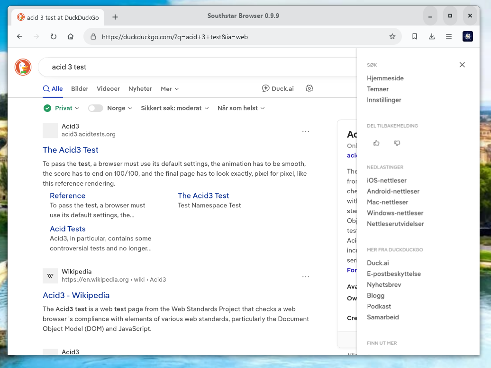

Southstar Browser
=================

Southstar Browser is a web browser focused on support for modern HTML, CSS
and JavaScript standards. It is the next step for
[Nordstjernen](https://github.com/nordstjernen-web/nordstjernen-browser)
(Northstar), **rewritten in Rust**.

The rewrite started from a working browser rather than an empty repository:
the Nordstjernen C codebase, its full history included, renamed to Southstar
Browser and trimmed to the desktop. It was then ported to Rust module by
module while it kept running, and in October 2026 the last of the project's
C went, the QuickJS-ng engine included. All of Southstar's own code is now
Rust; C remains only in the system libraries it links (GTK, Cairo, Pango,
OpenSSL, FFmpeg, SDL2, …).



**JavaScript engine:** Southstar runs page JavaScript on
[Boa](https://github.com/boa-dev/boa), a JavaScript engine written in Rust
(an interpreter, no JIT), forked into the tree at `third_party/boa_engine` and
extended there with the hooks the browser needs and the newest language
features. The bindings are Rust, over the engine layer in `rust/js-engine`.
It passes **all of test262** (52,133 of 52,133 tests outside `test/staging`,
October 2026), ES2025 and ES2026 included, with decorators, `ShadowRealm`,
`import defer`, source phase imports, an ICU-free `Intl` and `Temporal`.

Supported platforms:
* Linux
* Windows
* macOS
* FreeBSD and NetBSD

**Version:** 1.0.0.
[Changelog.md](Changelog.md) lists its changes and the Nordstjernen releases
it grew from.

**Standards.** Behaviour is measured against the spec text, section by
section, not against another browser. The walk-through of the in-scope
WHATWG HTML standard (§1–§16) in
[docs/HTML-compatibility.md](docs/HTML-compatibility.md) records **140 spec
rows fully implemented, 31 partial, 0 absent** (July 2026), besides a handful
that are non-goals by design: `embed`/`object` plugins, `frame`/`frameset`,
`applet`/`marquee`, telemetry, and AI-style web APIs. The tracked
web-platform-tests slice passes 95% of its subtests
([docs/wpt-scores.md](docs/wpt-scores.md)).

**Security.** Each tab's engine runs in its own sandboxed process (seccomp +
Landlock on Linux) behind an IPC + shared-memory-framebuffer boundary. No JIT.

**Minimalism.** The browser is about 330,000 lines of Rust in some 145
crates under `rust/`, excluding the vendored Boa fork and generated tables —
small enough for one person to read and audit end-to-end.


## Roadmap

- [x] Start from Nordstjernen: import the C codebase with its history, rename
      it to Southstar Browser, and remove the Android, iOS and Java versions.
- [x] Rewrite the browser in Rust: every C module ported, QuickJS-ng
      replaced by Boa, and the vendored C decoders replaced by Rust ports.
- [ ] Bring the Boa build up to and past the QuickJS-era browser on the WPT
      slice, Acid3, speed and memory.
- [x] Pass all of test262 (52,133 of 52,133; `southstar-jsshell test262`).

How the port was done (the processes, the engine's data model and the order
the modules moved in) is recorded in [docs/rust-port.md](docs/rust-port.md).

## Download

There are no Southstar binaries yet — build from source (below). The
per-platform build and packaging notes are in [docs/](docs/README.md).

## Browser features

- **HTML/CSS** — HTML is parsed by Southstar's own `rust/html5`; the CSS engine
  covers the modern cascade and CSSOM, Media Queries Level 4, container
  queries and units, flex, grid, transforms, gradients, animations and
  vertical writing modes.
- **Text layout** — text is shaped with **ns-pango**, a Pango fork
  pinned as a meson subproject that caches finished glyph strings and font
  metrics across layouts, so measuring and painting a run reach HarfBuzz once
  instead of three times. `-Dns-pango=disabled` links the system Pango
  instead.
- **JavaScript** on the Boa interpreter, with modern ECMAScript through
  ES2026 (iterator helpers, explicit resource management with `using`,
  `Temporal`, `Intl`) — DOM, Shadow DOM, observer APIs,
  Canvas 2D (`Path2D`, `ImageBitmap`, `DOMMatrix`), WebCrypto
  (`crypto.subtle` over OpenSSL), custom elements including customized
  built-ins (`is=` / `{extends}`), and the `Navigation` API for single-page
  routing, plus Web Workers, IndexedDB (over SQLite), WebSocket and
  `EventSource`.
- **Networking** over an in-tree Rust HTTP client (`rust/http`) — HTTP/1.1
  and multiplexed HTTP/2 with its own framing and HPACK over rustls (TLS 1.3
  and 1.2, post-quantum key exchange), FTP,
  HTTP CONNECT and SOCKS proxies, plus HSTS, CSP, subresource-integrity
  checks, partitioned cookies, speculative subresource loading, request
  coalescing and a `Vary`-aware HTTP cache.
- **Images and graphics** — pure-Rust decoders (`png`, `gif`, `zune-jpeg`
  and an in-tree BMP decoder) read PNG/APNG, GIF, BMP and JPEG; libwebp
  decodes lossy, lossless and animated WebP; ICO and SVG are rendered
  in-engine, with optional AVIF and inline PDF support.
- **Media** — `<video>` plays **inline** for MPEG-1 (decoded in-tree by
  a Rust port of [pl_mpeg](https://github.com/phoboslab/pl_mpeg)) and, when FFmpeg's libav is
  present at build time, **WebM** (VP9/VP8 + Opus/Vorbis). MSE/`blob:`
  streaming and HLS/DASH manifests play through the `southstar-video`
  helper, and a `<track default>` WebVTT file is drawn over the video. Other
  codecs render a poster and play overlay. See [docs/media.md](docs/media.md).
- **WebGL / WebGPU / WebAssembly** — WebGL 1/2 mapped onto OpenGL ES, on by
  default; experimental `navigator.gpu` over
  external wgpu-native, built only when that library is installed and gated
  behind `--enable-webgpu`; the full
  WebAssembly JS API over the pure-Rust [wasmi](https://github.com/wasmi-labs/wasmi)
  interpreter (`rust/js-wasm`).
- **MathML** — a minimalist presentation-MathML renderer (`rust/mathml`)
  laid out over Pango/Cairo and embedded inline on the text baseline.
- **Spell checking** — optional, via Enchant: misspelled words in editable
  text get a red wavy underline, honouring the `spellcheck` attribute.
- **Safe browsing** — a top-level navigation's host is checked against a local
  SHA-256 blocklist before it is fetched, entirely on-device; a match shows a
  full-page warning. Overridable via
  `~/.config/southstar/safebrowsing.list`.
- **Process-per-tab** — each tab's engine runs in its own sandboxed
  `southstar-renderer` process; the GTK app is a thin shell that blits the
  renderer's shared-memory framebuffer and forwards input over an IPC control
  channel, so a page can't take down the UI. `--single-process` runs
  every tab's engine in the shell process instead.
- **Privacy** — no telemetry or update pings, standards-compliant client
  hints, local-only safe browsing, partitioned cookies and a `--private`
  session mode.
- **UI** — tabs, bookmarks, history, downloads, find-in-page, printing and
  save-to-PDF, a JavaScript console, settings, headless mode, and a C
  embedding API (`src/libsouthstar.h`). The interface
  follows the operating-system language, with UI translations for 13
  languages so far (`data/i18n/`).
- **Extensions** — initial support for simple, page-facing WebExtensions
  ([docs/extensions.md](docs/extensions.md)).

## Build

```sh
sudo apt install build-essential git pkg-config meson ninja-build cargo rustc \
    libgtk-4-dev libepoxy-dev libssl-dev zlib1g-dev libbrotli-dev libzstd-dev \
    libuchardet-dev libpsl-dev libsqlite3-dev libseccomp-dev libwebp-dev libsdl2-dev \
    libavformat-dev libavcodec-dev libavutil-dev libswscale-dev libswresample-dev
meson setup builddir && meson compile -C builddir
./builddir/src/gtk/southstar
```

Rust 1.99 or newer is required. Rolling distributions ship it; elsewhere,
Ubuntu 24.04 and Debian 13 included, install it with
[rustup](https://rustup.rs), which reads `rust-toolchain.toml` and selects
1.99.0 in this tree. Windows, Fedora, openSUSE and macOS
instructions are in
[docs/](docs/README.md); keyboard, mouse and touch controls are in
[docs/Controls.md](docs/Controls.md).

## Dependencies

Southstar is an independent engine — no upstream browser code.

**Vendored in-tree**, built from the main tree with no submodules:
[Boa](https://github.com/boa-dev/boa)
(fork, no JIT), the [png](https://crates.io/crates/png), [gif](https://crates.io/crates/gif) and [zune-jpeg](https://crates.io/crates/zune-jpeg) crates
(memory-safe image decoding), [rustls](https://github.com/rustls/rustls) with
[ring](https://github.com/briansmith/ring) and RustCrypto's
[ml-kem](https://crates.io/crates/ml-kem) (TLS with post-quantum key exchange),
[pl_mpeg](https://github.com/phoboslab/pl_mpeg)
(MPEG-1 video + MP2 audio, ported to Rust) and [minimp3](https://github.com/lieff/minimp3)
(MP3, ported to Rust). The only setup-time download is
[ns-pango](https://github.com/nordstjernen-web/ns-pango), the text-shaping
fork; `-Dns-pango=disabled` links the system Pango and needs no network.

**Required system libraries:**

| Library | Min version | Role |
|---------|-------------|------|
| GTK 4 | **≥ 4.22.1 on Windows** (MSYS2 stock), ≥ 4.14 elsewhere (≥ 4.22 preferred) | UI toolkit, GSK renderer |
| GLib / GModule, Pango | (ship with GTK) | core types, dynamic module loading, text shaping |
| libepoxy | — | OpenGL/ES function dispatch for WebGL |
| OpenSSL (libcrypto) | — | WebCrypto (`crypto.subtle`) |
| zlib | — | gzip/deflate content decoding |
| uchardet | — | charset detection |
| libpsl | — | public-suffix list for cookie scoping |
| SQLite | — | IndexedDB persistent storage |
| libwebp | — | WebP decoding (lossy, lossless and animated) |
| SDL2 | — | audio output for the `southstar-audio` helper |
| libseccomp | — (Linux only) | syscall sandbox; no-op on macOS/Windows |

**Optional**, auto-detected or build-time-selected:
[FFmpeg](https://github.com/FFmpeg/FFmpeg) libav\* (inline WebM playback —
required on Linux and Windows, auto-detected on macOS), poppler-glib (inline
PDF), libavif (AVIF images), Enchant (spell checking), fontconfig / pangoft2
(extra font backends), libbrotlidec and libzstd (`br` and `zstd` content
decoding), and [wgpu-native](https://github.com/gfx-rs/wgpu-native) (experimental
WebGPU).

## License

Southstar Browser is derived from Nordstjernen and is distributed under the
same dual license: use it under **either** the Nordstjernen Source License
v1.0 **or** the GNU General Public License version 3 or later, at your option
(`LicenseRef-NSL-1.0 OR GPL-3.0-or-later`).

- **GPL-3.0-or-later** — free software: use, modify and redistribute it for any
  purpose, provided derivative works are also released under the GPL. See
  [COPYING](COPYING).
- **NSL-1.0** — use, modify and redistribute freely, except as a competing
  browser; each release becomes MIT after ten years. It is inspired by the
  [Functional Source License](https://fsl.software/).

See [License.md](License.md) for the full terms. Commercial licenses by
agreement. Bundled third-party components keep their own licenses
([THIRD-PARTY-LICENSES.md](THIRD-PARTY-LICENSES.md)).

## Related projects

- [nordstjernen-browser](https://github.com/nordstjernen-web/nordstjernen-browser)
  — the C browser Southstar starts from.
- [northstar-browser](https://github.com/nordstjernen-web/northstar-browser)
  — the GPL-licensed sibling project.

# Development team
Southstar is developed by a team located in Norway, Poland and Spain.

[Join the Discord](https://discord.gg/4W959nW5vF)

## Builds
[](https://github.com/nordstjernen-web/southstar-browser/actions/workflows/linux.yml)
[](https://github.com/nordstjernen-web/southstar-browser/actions/workflows/macos.yml)
[](https://github.com/nordstjernen-web/southstar-browser/actions/workflows/windows.yml)


----

Copyright 2026 Andreas Røsdal
